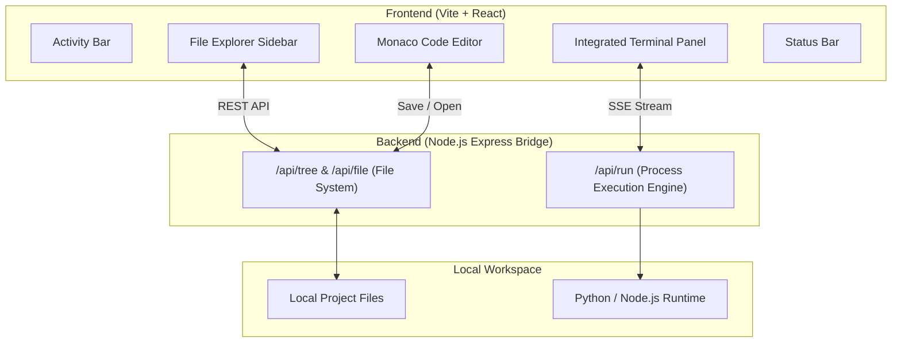

# ⚡ Nemesis IDE

<p align="center">
  <strong>A modern, lightweight, web-native desktop IDE built with React, Monaco Editor, and Node.js.</strong>
</p>

<p align="center">
  
  
  
  
  
  
</p>

---

## 🌟 Overview

**Nemesis IDE** is an open-source, extensible integrated development environment engineered to provide a snappy, VS Code-like editing experience with a minimalist footprint.

It brings together:
- **Monaco Editor Engine**: The official text editing core behind VS Code with full syntax highlighting, bracket pair colorization, minimap, and multi-cursor support.
- **Node.js Local Bridge**: Seamless file system CRUD operations and sandboxed workspace isolation.
- **Integrated Live Runner & Terminal**: Real-time streaming output (`stdout` & `stderr`) via Server-Sent Events (SSE) for executing Python, JavaScript, and arbitrary shell commands.
- **Extensible Architecture**: Clean component separation ready for Language Server Protocol (LSP), plugins, and Electron packaging.

---

## 🏗️ Architecture



---

## ✨ Features

- 📁 **File & Folder Management**: Create, view, rename, and delete workspace files in real time.
- 🎨 **Monaco Editor Core**:
  - Auto-language detection (`.py`, `.js`, `.ts`, `.json`, `.html`, `.css`, `.md`, and more).
  - Customizable theme (VS Dark, Light, High Contrast).
  - Configurable font size, tab size, minimap toggle, and word wrap.
  - Shortcut support (`Ctrl + S` to save directly to disk).
- ⚡ **Integrated Live Runner**:
  - One-click **Run Code** button for Python & JavaScript scripts.
  - Real-time streaming output without blocking the UI.
  - Interactive terminal prompt for running shell commands.
- 🖥️ **Standalone Desktop App & Auto-Updater**:
  - Native Windows desktop application via Electron.
  - Seamless background auto-updates powered by `electron-updater` & GitHub Releases.
- 🎯 **Status Bar & Metadata**:
  - Live cursor position (`Ln`, `Col`).
  - Active language and encoding indicator.
  - Server health status.

---

## 🚀 Getting Started

### Prerequisites
- [Node.js](https://nodejs.org/) (v18.0 or newer)
- [npm](https://www.npmjs.com/) or [pnpm](https://pnpm.io/)
- Python 3 (optional, for running Python scripts inside the IDE)

### 1. Clone the repository
```bash
git clone https://github.com/arazzki/NemesisIDE.git
cd NemesisIDE
```

### 2. Install dependencies
```bash
npm install
```

### 3. Run development mode (Web Browser)
```bash
npm run dev
```

Both the backend server (`http://localhost:3001`) and frontend app (`http://localhost:5173`) will boot up concurrently. Open your browser at `http://localhost:5173` to start coding!

### 4. Run as Standalone Desktop App (Electron)
```bash
# Mode Desktop Development (live hot-reload)
npm run desktop:dev

# Mode Desktop Production Preview
npm run desktop:preview

# Package ke file biner Windows (.exe di folder release/)
npm run desktop:dist
```

---

## 📂 Project Structure

```text
NemesisIDE/
├── server/
│   └── index.js             # Express backend: File System & Process Streaming APIs
├── src/
│   ├── components/
│   │   ├── ActivityBar.jsx   # Left icon navigation bar
│   │   ├── Sidebar.jsx       # File tree explorer & settings pane
│   │   ├── EditorArea.jsx    # Monaco editor container with tab management
│   │   ├── TerminalPanel.jsx # Bottom output console and command runner
│   │   └── StatusBar.jsx     # Bottom status indicators
│   ├── utils/
│   │   └── languageHelper.js # Extension mapping and badge helpers
│   ├── App.jsx              # Main React orchestrator
│   ├── index.css            # Tailwind directives and custom scrollbars
│   └── main.jsx             # React DOM entry point
├── workspace/               # Default sandbox folder for user code
├── index.html
├── package.json
├── tailwind.config.js
├── vite.config.js
└── CONTRIBUTING.md
```

---

## 🗺️ Roadmap & How You Can Contribute

We welcome open-source contributors of all skill levels! Here are some features on our roadmap that you can help build:

- [ ] **LSP Integration**: Add Language Server Protocol support via WebSocket for auto-imports and diagnostics.
- [x] **Electron Wrapper**: Package Nemesis IDE as a standalone native desktop binary (`.exe`, `.dmg`, `.AppImage`).
- [ ] **Git Integration**: Sidebar panel for Git diff, stage, commit, and push.
- [ ] **Tab Split View**: Support split editor layout (side-by-side editing).
- [ ] **Search across Files**: Global regex search and replace across the workspace.
- [ ] **Plugin System**: Allow users to install community extensions and custom themes.

See [CONTRIBUTING.md](CONTRIBUTING.md) to learn how to submit issues and pull requests.

---

## 🤝 Contributing

Contributions, issues, and feature requests are welcome!  
Feel free to check [issues page](https://github.com/arazzki/NemesisIDE/issues).

1. Fork the Project
2. Create your Feature Branch (`git checkout -b feature/AmazingFeature`)
3. Commit your Changes (`git commit -m 'feat: add amazing feature'`)
4. Push to the Branch (`git push origin feature/AmazingFeature`)
5. Open a Pull Request

---

## 📄 License

Distributed under the MIT License. See [`LICENSE`](LICENSE) for more information.

<p align="center">Made with ❤️ for developers by the Nemesis IDE Community</p>
